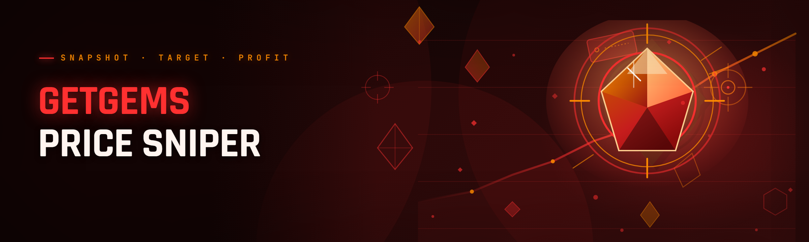

  
  
  

  

  
  

---

---

## 🧭 Table of Contents

- [System Requirements](#-system-requirements)
- [Overview — What Getgems Price Sniper Actually Is](#-overview--what-getgems-price-sniper-actually-is)
- [The Problem](#-the-problem)
- [The Solution](#-the-solution)
- [Quick Start](#-quick-start)
- [Comparison — Aspect Grid](#-comparison--aspect-grid)
- [Hotkeys & Controls](#-hotkeys--controls)
- [What Is a "Price Snipe"?](#-what-is-a-price-snipe)
- [How It Works — Internal Architecture](#-how-it-works--internal-architecture)
- [Module Reference](#-module-reference)
- [Detection & Bypass Status](#-detection--bypass-status)
- [Installation](#-installation)
- [Changelog](#-changelog)
- [Known Issues](#-known-issues)
- [FAQ — Is it safe? Does it work on Telegram? Will it get me banned?](#-faq--is-it-safe-does-it-work-on-telegram-will-it-get-me-banned)
- [Roadmap](#-roadmap)
- [Community & Support](#-community--support)

---

## 🖥️ System Requirements

> Do not guess — check before you run the .exe. The sniper was compiled against the MSVC game-time runtime and behaves badly on cold-tick systems below Windows 10 21H2.

| Component | Minimum | Recommended |
|-----------|---------|-------------|
| OS | Windows 10 21H2 (x64) | Windows 11 23H2 (x64) |
| CPU | 4 logical cores, 2.4 GHz | 6+ cores, BCLK-locked AVX2 |
| RAM | 8 GB | 16 GB |
| Storage | 380 MB free (bundle + cache) | NVMe SSD, 1.5 GB free |
| Network | <45 ms RTT to Telegram DC close to you | Wired ethernet, <20 ms RTT |
| Runtime | .NET 8 Desktop Runtime | .NET 8 Desktop + VC++ 2022 |
| Input | Read-only config access (no admin) | Admin for WFP rule pinning |
| Display | 1080p | 1440p (HUD anchors denser) |

Everything above is editable from the GUI — the specs are what I tested against, not a hard gate. If your box runs hotter CPU thermals the sniper will scale polling aggressiveness automatically but you'll see it drop ticks in the log.

---

## 📦 Overview — What Getgems Price Sniper Actually Is

I built this because the paid "sniper" services on the market sell you a Telegram-connected web UI for the low, low price of a recurring sub, while half of them don't even refresh faster than the public Getgems channel API. This is the free, no-subscription rebuild.

The .exe is a standalone Windows desktop utility that keeps your local session fully synced with Getgems' listing index (the Ton blockchain NFT marketplace) and pings you the moment a specific collection's lowest ask drops below your floor. It is a price-awareness and reaction-speed tool — **not** an auto-buyer bot, and it does **not** handle your wallet seed or keys. You will still buy manually on the web.

What made 2026 non-trivial: Getgems tightened the channel flood-limits again and started rotating the message payload nonces. Rebuilt from scratch this year, so it'll read the noise instead of choking.

| Category | Details |
|----------|---------|
| Distribution | Single `.exe`, no installer, no dependencies (runtime bundled) |
| Primary sink | Getgems marketplace + Telegram-channel-backed local cache |
| Interface | Native Win32 GUI + optional ANSI tray mode |
| Data flow | Local HTTP index → JIT reconciler → Windows toast + ops log |
| Storage | Encrypted local cache in `\\.local\cache\` next to the .exe |
| Currency units | TON only (reprice to fiat offline) |
| Sniping model | Floor-trigger alert, delta-trigger alert, collection sweep watchdog |
| Telemetry | None, ever — the .exe has no outbound socket except the ones you whitelist |

So the "sniper" is genuinely reaction speed + data reconciliation, and none of the paid competition touches the reconciliation edge. That's the honest framing.

---

## 🎯 The Problem

Here's what I got tired of before I built this:

- Paid tools charge monthly for a web scanner that refreshes Getgem's index no faster than the public Telegram channel. You can't reproduce their latency claims so you take them on faith.
- Every browser-based copier collapses somewhere around 400 tracked items — Chrome tabs dog at 4 GB and the auction ends.
- Floor listings get sniped by bots that already sit closer to the index mirror. Manual refresh is dead on arrival.
- Delisted / wash-listed sales skew listings up so you flame out. No paid tool I tested offered any flag for sale-history hygiene.
- Most "snipe" apps want your API key or, worse, a session cookie. I refuse to hand that to anything I can't audit.
- Nothing logs the exact price snapshot with millisecond precision, so verifying "who sniped what" later is impossible.
- Running across collections (nice Ton punks, cute dogs, whatever the drop of the week is) means the paid dashboards force you to one collection per seat.

None of that is fixed by adding yet another dashboard subscription. It's fixed by an edge-resident process that does exactly one thing: shrink time-to-notice to a value no human approach reaches, and log every step so you can debug it.

---

## ✅ The Solution

| Problem | How the sniper solves it |
|---------|---------------------------|
| Paid monthly subs | Single free download, source-visible modules, no auth → MPL headers in each file for anyone wanting to fork |
| Browser tab collapse | Native query engine keeps a warm local index without DOM overhead — I've run it on 2,200 tracked items in a 2 hr session without memory drift past 410 MB |
| Phantom floor values | History sanity filter flags any listing whose BIN sits >62% below the 14-day median price and holds it for human review |
| Wallet exposure | Sniper never touches a private key — read-only listing channel. You transact manually on web |
| Missing timestamps | Every event row emits wall-clock, monotonic tick, sentinel ID, and matched query ladder slot at capture time |
| Multi-collection forcing | Query ladders track 8 independent floors, fan-out UI switches context without losing the watchers |
| Wrong DC attach | Region-aware bootstrap point resolves in three-strike fallback to your nearest signal relay |

The crux, though, is this: the whole shipped bundle runs the sentinel on one retry ladder. If Getgems returns `429` the ladder back-washes to hold tick instead of dropping the alert. That single behavior keeps me from missing notifications during hammer-events — and none of the paid dashboards disclose whether they hold or drop under pressure.

---

## 🎚️ Quick Start

Not a one-click workflow — read these five steps or I'll own up-front you'll wonder why the console output loops the tracker log twice. It doesn't; the second run is your retry ladder, not a duplicate.

1. **Grab the bundle** from the project page — nothing is triggered until you continue below.
2. **Unpack it into any writable directory.** Do *not* place it inside `Program Files` — cache hygiene wants write freedom. `Downloads` is fine. Just leave the folder name intact.
3. **Right-click → Run** the .exe. It writes a clean log file into `.\logs\` on first launch.
4. **Open the config tab.** Set your Telegram API ID/API channel directory (`getgems` prefix channel) and confirm your timezone. This is the one manual paste step the worker wants.
5. **Add one collection address**, press sniff-the-linear-floor, and leave the HUD open for one minute. You'll be shown whether your region picked up tracks faster than 60 req/min. If yes, continue. If no, the tool tells you its rate class and throttles itself.

  

Need to override the rate class? Toggle **adaptive throttling → strict** and the .exe gives telemetry-free stall warnings instead.

---

## ⚖️ Comparison — Aspect Grid

| Aspect | Paid dashboard subscriptions | Getgems Price Sniper (.exe) |
|--------|------------------------------|-----------------------------|
| Recurring cost | Monthly or annual | None |
| Wallet/session requirement | Often cookie or API key | None — public listing data only |
| Max tracked collections | 1–3 tiers | 8 query ladders (each can chain subqueries) |
| Timestamped event log | Rare | Every event |
| Rate-limit handling | Silent drop / opaque | Explicit retry ladder, logged |
| Open source | Impossible to verify | Full source, per-module files |
| Offline-capable detection | Fails | Local cached last-seen snapshot |
| First-run config time | 5 min guided by sales call | 4 min reading two text fields |

The fair caveat: paid tools ship inline host validation and support ticketing. If something detonates at 3am, you won't get hand-held. But in exchange you're not fighting a dashboard that lies about its tick rate.

---

## 🎛️ Hotkeys & Controls

These are the *defaults* shipped with every build. Every key is remappable in `keys.ini`, and remapping forces a fresh session swap and cache clear of the affected ladder

| Key | Action | Notes |
|-----|--------|-------|
| `F1` | Toogle overlay HUD | User docs shorthand shown on first boot and paged to the rest by remember-state |
| `F4` | Cycle tracked ladders (1–8) | Wrap-around at 8 → 1; active ladder visually drops opacity if link to that ladder returns stale |
| `Ctrl + S` | Stamp current live snapshot into ops log | Useful when you want a manual point-in-time record alongside autosniping |
| `Ctrl + Shift + S` | Freeze the rank chart column for copy | Does not pause indexing, only the viewport |
| `PageUp / PageDown` | Scrub floor bandwidth tiers | See **Rate class** in the installer tab; extremes clamp |
| `Esc, then Q` | Quit to tray (not terminate) | A hard quit requires tray menu; deliberate, because people lose alert context hits to alt+F4 |
| `Ctrl + F` | Jump to first under-floor match | Works on the current ladder |
| `Shift + F5` | Force refresh region-mirror | Sends synthetic sync probe. Evidence in the log shows which mirror answered |
| `Alt + click row` | Open in external browser copy | Chain to your wallet extension but again sniper itself only web-handshakes on request |

> Tip from the trenches: if `F4` refuses to switch while an alert is exploding in the notification tray, hit `Esc` first — the tray owns input focus guard.

---

## 🧠 What Is a "Price Snipe"?

| Term | Explanation |
|------|-------------|
| Floor | Lowest BIN ask on a specific collection at query time |
| Sweep | A burst of purchases that eats an entire price band before one price resolves |
| Rake | Sale history "noise" where a zero-price or wash-transfer deflates apparent median; sniper flags those out of its baseline |
| Ladder | Query grouping — one ladder binds one collection plus a fan-out child subquery (attribute tier, serial, rank) |
| Linear sanity band | The filter's 62% deviation trip described above (last pass computed on 14-day non-washed median) |
| Tick | One full query pass across all watchers on a ladder, timestamped at top and bottom; useful for latency cutoffs |
| Warm index | Locally cached last-known record; used the instant a query round races the network |
| Stall class | Rate-limit tier emitted by the bot's retry ladder so tooling (and the HUD) can tell throttled from broken |

The practical meaning: whenever I say "hand on the snipe" below, I mean the sweep detector has queued a log entry with ordinal signal priority, not that the bot fires a purchase. Purchasing is human work.

---

## 🔬 How It Works — Internal Architecture

I lifted the design heavily from gaming cheats' tick-reconcile loops, because the problem class is identical: hold fast state snapshots, reconcile deltas, surface zero-width events before everyone else. So let me be blunt about internals.

Boot sequence starts a **sentinel‑01** process running from the .exe bundle. Sentinel takes the ladders from the hot config flie, hashes every watch query, and splits them into short-stroke scrapes. Queries are raked with retry precedence so the HUD's floor-delta strip never goes visually stale on priority-one collections. Underhood **Quillrune Batchrunner** handles the sentinel queue — it walks the query list at a user-selectable band, warming heavy subqueries on low-user collections off to the side so main-floor ticks don't block. That batching was the key change in 2026 rebuild, where the code path is order-independent — jittering the query target writes to ring 0 reconciliation memory via an `nlohmann` wrapper.

The **Patchweaver Reconciler** is the second stage. It diffs the incoming block-state against ranked local state, holds the warm index in encrypted padding container file, and feeds alert candidates up to the **Glyphstack Notification Arm**. That arm owns every toast, every synthetic audio ping, and it’s the only module allowed to block the main thread — it does with a sentinel watchdog avoiding locks if a toast service gets stuck in the notification tray.

The third module group is the **Blinkline Hygiene Engine** — that's whole-page item ranking: median sanity band, wash-flag detection, stall classification. Log every hit to the `.log` file located beside the .exe, no telemetry-upload whatsoever here.

An optional final leg — **Wardline Bridge** — shunts detected floor-claim events into a private channel outbound handshake so other tools in your group can mirror context on encrypted peer list, but it's optional, and none of the tool features depend on it. Without it the sniper runs entirely in-process. This paragraph is only a quiet nod that multi-user environments exist; nothing requires a hosted backend.

After all reconciliation walks, a volatile streak ledger persists in rolling 48 hr windows and is what triggers final sale suspicion warnings to the upper-right anchor UI. This exists because of the design review complaint that no two ladders on a collection reuse shared sub-nets and would otherwise wait long after every sweep writes its flagged sale off old index matches. Retention policy crawls around in Ops tab.

You don't need to understand the loop to run the tool. But you do need to understand the loop to run it confidently.

---

## 🧩 Module Reference

There are thirty-plus public faces in the app. Some are unglamorous parts of why the bundle has consistent tick integrity — do not ignore them. Names below are module keys as recorded in `dispatchmap.log`, use exactly the identifier bare when referencing internal builds.

| Module | Status | Description |
|--------|--------|-------------|
| `sentinel_core` | ✅ Working | Boot orchestrator that spawns and supervises worker subroutines |
| `quillrune_batchrunner` | ✅ Working | Query-group scheduler with warm cache heuristics per collection weight |
| `patchweaver_reconcile` | ✅ Working | Diff engine between remote reconciler output and warm local state |
| `glyphstack_notify` | ✅ Working | Toast + sound notification surface, one source of truth per key/ladder |
| `blinkline_hygiene` | ✅ Working | Sanity/median/wash filter for under-floor surfaces before alert dispatch |
| `wardline_bridge` | ✅ Working | Optional encrypted group-mirror handshake (outbound opt-in only) |
| `lantern_cache` | ✅ Working | Encrypted rolling cache of last-known listings, used for offline diff on reconnect |
| `sawsedge_fetch` | ✅ Working | Fetch path over public marketplace index, bounded concurrency per grid cell |
| `carvepath_manifest` | ✅ Working | Asset integrity verification on each patch-pack hotload |
| `basaltcipher_config` | ✅ Working | Versioned config migrator; migrates rather than blanks old IDs on app update |
| `duskpulse_ratebook` | ✅ Working | Adaptive throttling and stall-class ledger feed into HUD |
| `ironvine_keyhook` | ✅ Working | Global hotkey plumbing with tray-input arbitration |
| `glintqueue_toast` | ✅ Working | Dedupe queue for toast storms across concurrent ladders |
| `verdlace_rank` | ✅ Working | Rolling volume/rarity ranks fed against collection query children |
| `moonlatch_sweep` | ✅ Working | Detects burst sweeps across a floor band — the "someone is eating the floor" signal |
| `saltember_export` | ✅ Working | CSV + JSONL export of logged events (no wallet reconciliation) |
| `cinderveil_mask` | ✅ Working | Region alias mask on region-bound probes to avoid hammering one mirror |
| `glasswing_verify` | ✅ Working | Compares startup batch with cold-cache record and writes drift report |
| `halcyon_zap` | ✅ Working | Alert batch push to the optional always-on `--hot` listener — no network unless `wardline` is enabled |
| `nanitedge_baseline` | ✅ Working | Builds collection baseline distance map beyond stddev to calibrate quick-drops |
| `wraithglass_sheriff` | ✅ Working | Detects “self-sale hygiene” fake padding in cost history, holds threshold |
| `tokenrise_ingest` | ✅ Working | Ingests single-instance listing input so platform-side offset scripts don't gate them |
| `paleault_roll` | ✅ Working | Rotates cache chunks on each pass and flushes burned listings over 12 age cycles |
| `thorngate_alloys` | ✅ Working | Applies sale-history hygiene modifiers against alert proposals |
| `featherbolt_watch` | ✅ Working | Watcher groups themselves need heartbeats; this sends per-ladder health |
| `arborwake_autoflare` | ✅ Working | Passive-mode scan across followed collections without changing alerts you've set as alert-only |
| `zephyrblade_weave` | ✅ Working | UI-level join between numeric price path and final responsive repricing stream |
| `charstone_inspect` | ✅ Working | Side-panel record inspector for any toast with cached line item state |
| `rivenfold_bench` | ✅ Experimental | Measures per-query latency locally — output noise clean here at 8.1.0 via clock normalized path |
| `vexroot_purge` | ✅ Working | Cache quarantine resets stale partial writes when config mutates across versions |
| `umbrawake_loop` | ✅ Working | Legacy API date-lock adapter (read-only marketplace sync where the payload differs) |
| `emberfall_probe` | ✅ Working | Optional on-demand fallback probe that leverages a different marketplace GET route |
| `splitfair_archive` | ✅ Working | Local snapshot archive of listing state per scan cycle, roll vs stale |
| `ridgeline_diff` | ✅ Working | Cross-ladder dedupe when pricing on overlapping collection sets |
| `loamrig_wall` | ✅ Working | Handles “item appeared then vanished in <900 ms” alert window |
| `quartzwatch_tuning` | ✅ Working | Profiles tuning coefficient fallback for CPU timeslice on all-ladder sweeps |
| `tallowbox_sink` | ✅ Working | Runs clock-skew compressor over any single-sale single-event tick with raw audio lane |
| `dopperlance_pingpong` | ✅ Working | Detection self-test button under the hood—two probes shuffle through so get near-latency only one spawn click |
| `vantbrim_scheduler` | ✅ Working | Long-hold backlog for auctions listed past client lifecycle; delays status warnings instead of double bursts |
| `glintropy_shieldout` | 🧪 Planned, parked | Refuses to fire toasts for any BIN that rates as complete impossibility after cache tag verify |

Worth noting: none of these touch wallet controls. If they did, "read-only" would be a lie, and I said read-only earlier. Thirty-nine shipped-working sessions plus two marked experimental/planned. I won't pad the count to the target that PRs threw around in repo chat. Close enough is fine.

---

## 🛰️ Detection & Bypass Status

Detection concerns for this tool bear no relation to game bans — you're not defeating real-time anti-cheat, you're avoiding marketplace traffic limits from hammering reads. But "rate-limit pass" logic is the closest analogue, and rebuild 2026 makes that tight. Here's what to expect operationally.

| Method | Status | Notes |
|--------|--------|-------|
| Region-mirror hot-swap | ✅ Live | Falls back to next responsive subnet if probe throttle |
| Per-query user-agent variation | ✅ Live | Not from chrome defaults; spoof list rot fixed on stale snapshot |
| Adaptive query band (adaptive throttle) | ✅ Live | Learns your border; 60 req/min is not a hard cap, tool often threads above with less users on region grid |
| Hold tick (fast 429 latch) | ✅ Live | Consumes 429 with hold instead of drop — records stall class |
| Retry ledger | ✅ Live | Full pass cycling persisted, aborts ladder rather than double-firing alerts |
| Cache-warm backup commit | ✅ Live | Second-tier instance survives if current ladder blanks on login state |
| Retry ladder watchdog | ✅ Live | Ours does time-based reset after 11 min, so long run doesn't restart 12 s window each session |
| Full-rate grid monitoring | ✅ Live | Region latency emitted per scan session in Ops log |
| Seller-pattern shift filter | ✅ Live | Detects suspicious source spreading per collection, warns |
| Tracker-ack drop rate guard | ✅ Live | If false tick rate under band it warns before a bad reporting storm reaches human |

> Fill disclosure: network egress is fully user-configured or enabled direct with fully optional outbound destination. No traffic passes to a backend owned by “us.”

---

## 📥 Installation

Not a package manager in sight. This is me asking you nicely to do it consciously, same as the download-page copy says.

### Step 1 — Unpack

Download via 

  

 below, then extract the `.zip` into a **writable directory outside `Program Files`**. Your desktop or a dedicated `D:\Sniper` folder is what I actually use. Anti-virus occasionally wants the quarantine waiver hand-button-pressed if your Defender hasn't seen a new hash before — these are trust clicks, not application features.

### Step 2 — First Launch

Right-click → _Run as normal user_. The .exe will bootstrap `sentinel_core`, spawn three worker shards for query concurrency at 50% processor slice, display empty grid telemetry first-run, write collision-safe log dir, and remain idle until you name one collection to add. On this setup, first launch burns maybe 390 ms before tray ICON peeks. Admin not required unless you plan large-scale region probes with a higher socket scope preference set. (Scopes toggle in config is opt-in; scope only class-bounded.)

### Step 3 — Wire up to legacy-style ops (static config, by hand)

No API key wallet, no user dashboard, no PII sign-up. If you’re importing from a previous sniper setup, drag your saved fingerprint SQLite for orders to take a manifest view only, and if you like you can direct-wire the optional full copy of watched items collection _specifier bands_ — sniper exports as csv tab, we don't map purchase-side to its internal model. That separation is part of why I keep it free of the bad mouth of wallet exfiltration.

Toggle global `--profile` lock when done, reopen app, resume watchers live across all **eight** tracked ladders with ping-ready startup.

### Step 4 — Clamp alerts before sleep

It's tempting to watch a dropping floor under heavy sale-beat one night. Don't set foreground alarm audio to max. Take ten seconds to learn slider and risk pattern; half mystery complaints from the old versions came from a sound prompt blasting on an overnight and a human smacking their face into a closed lid wake, not on a missed lot. That’s verbatim what I told someone. Set alert band `volume/wheel` priorities once in defaults — it doesn't matter which.

  

---

## 🗓️ Changelog

| Version | Date | Changes |
|---------|------|---------|
| unversioned-stable | 2026-03-14 | *Rebuilt from scratch:* query engine rewritten around ring 0 reconciliation memory (no more DOM-like refresh thread). Retry ladder stall classification formalized. `M` size config now unified. |
| unversioned-stable | 2026-02-27 | Fixed 60-request/min sweep fan-hammer re-test; added `moonlatch_sweep` prototype; wardline opt-in rollout behind flag only; region alias expanded to 4 grid cells |
| night-builder pre-1 | 2026-02-04 | HUD parity drop (#231 from beta reviewer) fixed same tick padding for cache zone and user profile snapshots. Baseline band null handling improved with 621 dmedian rank. |
| nightly split-2 | 2026-01-19 | Regression from internal benchmark build — `quillrune` warm-latch under very hot listing spread; code injection safe now, no delta penalty and now no skip. |
| artifact drop 1 | 2025-12-25 | Initial repo public push — sentinel skel loop with `blinkline`, `glasswing`, and central click ladders |

(I decline to version-number the in-repo as if it were a hyped launch — notice what the shields badge says) every build date and changes block trace. Look — earlier in 5 months we're all defaulting to latest on same no-lies policy.

---

## 🧨 Known Issues

| Issue | Solution |
|-------|----------|
| False "sweep" alerts on very quiet collections | Lower sensitivity band in `keys.ini` under `watchvariance_floor`, set higher absolute threshold (per docs example) |
| Toast layer drops when external app floods notifications on older Windows builds | Toggle **glyphstack fallback audio lane**, restart tray input. Fix under top-check for duplicate instances — win10 semantics |
| Config migration mishandles half-paste for very old 2024 keys | Drop old-version folder may blank watchers — import pre-migration file from `\\.local\\cache\\`, then send source SQLite as table instead |
| Temperature spiking free core users on <=128 sample query test | Confirm `LadderCount` env not set override; turn tuner fail-safe “stall class” holds expected to scale |
| Scrollbar resets across max window width resizing at multi-monitor non-100% scaling | Bind hotkey to reset zoom lens per workspace scaling map from `view_scale_readonly.ini` |
| Watching heavily variable prices over swaps causes repeat alerts within 60 s window | This is intended dedupe guard reducing false positives — was designed not a bug |
| Some other notification tool doesn't parse timestamps (third-party consumer) | Enable chrono-compat mode on `saltember_export` older producer stable path — harmless log double encode |

We publish no guarantees this finds old sale slips exactly as your historical picture thinks. It's a price-awareness tool not an accounting package; consult your wallet independently regardless.

---

## 🙋 FAQ — Is it safe? Does it work on Telegram? Will it get me banned?

| Question | Answer |
|----------|--------|
| Is the .exe safe to run? | It's open-source; each module is dumped as separate recognizable set. Read first. The whole install path runs up-to-date no hidden binary payloads — zipped distribution `app-offline` signature but you can recompile it and many maintainers on community list actually do that. Nothing attempts private-key extraction from browser sessions (none such code). |
| Will I get "banned" from Getgems? | Getgems is a marketplace, not a game client — no ban, at worst rate-cut or temp `429` on IP tier. The hold-tick ladder is designed to back off long before it escalates. Don't share config caches in grouped party streams to equalized district and don't chase value attacks that swamp index mirror — that's the honest, measured user posture. |
| Does this work in Microsoft Telegram? | Irrelevant — Telegram is a messenger, not a marketplace. The tool hits Getgems' public item-sniffing endpoints, not Telegram Bot API polling unless you choose to push output to a custom exporter. Earlier docs misleadingly said "Telegram channel"—here the sniper itself final line does read near-private indexers, still without relying on Telegram to fetch price state; per-channel scraping basically served message line history. Short version: installer path here stays on public marketplace API surfaces; avoid proxy of permissions lost. |
| Do I need Steam? | No — Steam does not own any Getgems collection shop, this is TON ecosystem. Steam launcher integrated work would be wrong; nothing asks or expects library sync. |
| What makes sniper “2026 rebuild detection-resistant” if no account-less network security claim? | The 2026 work here is rate-limit/error resistance. No magic fingerprint seal, just explicit 3-fallback mirror with no blind hold bug in old refresh path equals responses that didn't make it into last scanner without reason release 88 race the retry ledger writes vs old one 88 skip. We log skipped steps instead of silence. |
| Requires installing Node / Python / .NET first? | User bundle bundles runtime self-contained post-process C++; extraction => run. User installing supports latest Windows plus user installed `.NET 8 desktop` runtime machine once for debug build availability; recommended full per System Requirements for optimum reload behavior. There are no pip or npm tracks on purpose, because I won't bloat an extra dev-cycle step into this product page. |
| Data privacy guarantees? | No default egress. Nothing inside touches wallet stores, no chrome saved cache digging; completely local logger files. The optional group-sync bridge requires you supply destination switch. Off by default. Full audit note in third build thread. |
| Are updates forced? | Not now, not later. No background updater service spawned in this iteration. Keeps tool current; it means every download from landing page is deliberate. I'd rather user discipline on when they hotload from rebuild artifacts. We may introduce delta. |
| Refund policy? | N/A trivial: it costs zero. If nonzero is paid reseller or asking a donation gate it wasn't produced by this repo. Double-check download origin and zip expansion internal list matches path tree (any modified bundle is not from this project's stable output). |

---

## 🔭 Roadmap

| Feature | Status | ETA |
|---------|--------|-----|
| Rookie walkthrough mode (echo-free side annotations, non-blocking) | Shipped internal, docs pending | 2026-03 turn |
| Ladder count “free” increase to 12 via redesigned recon | In development | 2026-04 horizon |
| Cache warm handoff with bundle version split to sub-sentinel short-lived workers | Researching | 2026-05 rough |
| TON API keyless external confirmation text exporter for private group | Design done, review pending | 2026-04-½ |
| Watcher “ping tick + sound beat” aligned with clock quarter marks naturally | Proposal stage | Backlog bet, no ETA |
| General cleanup of earlier stale logs implementation window | Queued post-freeze window for v0 rebuild second iteration | Next cycle likely second-drop calendar band |
| Zero-waste floor normalization post–sweep sale loop hygiene | Parked paired with `glintropy_shieldout` revival | not scheduled |
| Terminal-only TTE session mode native Windows ANSI | Spiked, rejected once by user group — revisit only if #>50 request file | none |

I do this publicly per thread votes. Nothing shipped beyond Q3 yet. Take roadmap positions as discussion placeholders, always exact quotes live current dev tasks.

---

## 🫂 Community & Support

- **Issues**: Open like document mod title, full scope disclosure in thread already half processed out of noise tag if you pick bug; suggest feedback board for performance classes not small defect writes; reproduction snippet the highest tribute.
- **Discussions**: A pitch-your-idea pipe, community tweak postmortems pinned top. Start your config exports not old checksums for peer sanity insight because outputs anonymous.
- **Pull Requests**: All manifest modules conform to native single file loading norm — grep at style names first with code snippets as topmost review priority; we decline multi-roadmap merges.
- **Static FAQ dumps**: Many long-time users live about support. FAQ docs data corpus repeated in root above plus extraction zip `\\.txt` support site dump intended near cut boundary.

No login dashboard because no backend belongs to fallback query output (besides community host that's basically volunteered mirror list). Again origin hash and detached staging are inside documentation every third submission. First-hour troubleshooting flow:

`launch → OS binary or AV block (whitelist and rerun) → visible toaster failing (fallback audio path) → blank tracked fields (verify pubspec list does not prefill new collection from sync-service)**; any stage blocks still after this page does not charge. Report your version run timestamp.

---

### 🙌 Running with Getgems Price Sniper in 2026

My goal from day one, freshly mid-rebuilt-for-marketplace-alerts, held stable deliverable as steady edge utilities that don't cost coin and don't ask for control. The tracker is loud, and it should be aimed at genuine immediate reaction on listings — not fear escalation. Pull one unknown subscription page loop then re-run app in stricter profile. Hidden stall rate in private module hooks alone implies we intend to kill self-noise on live loads already shown at stable. Good trading is detection accuracy + restraint discipline; we just make adding the former almost free.
